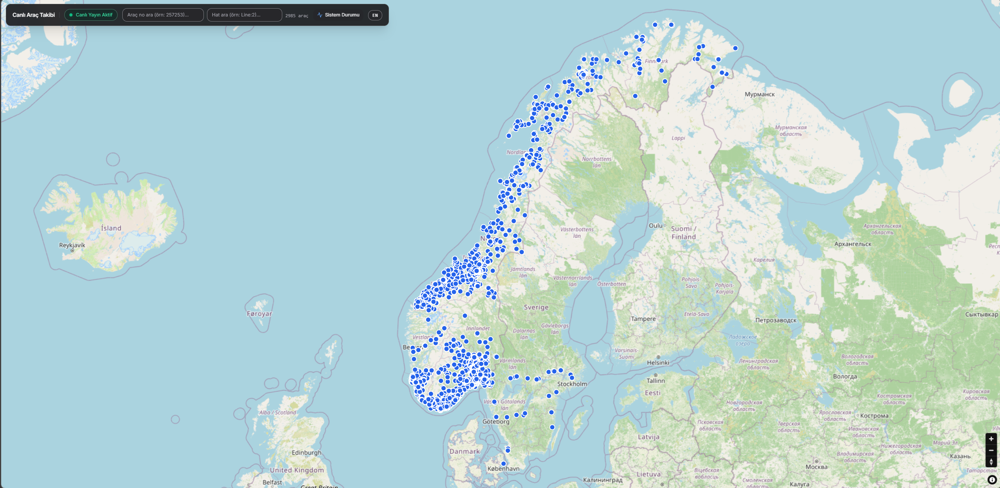
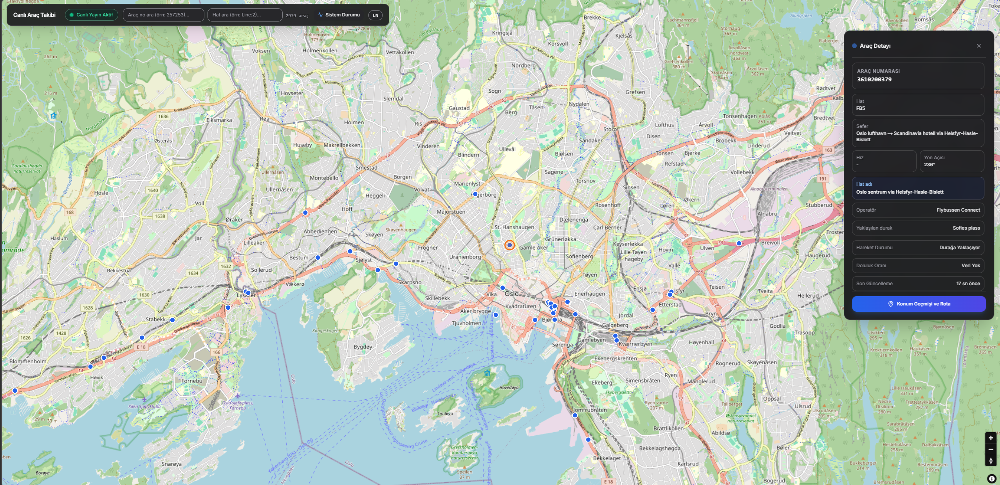
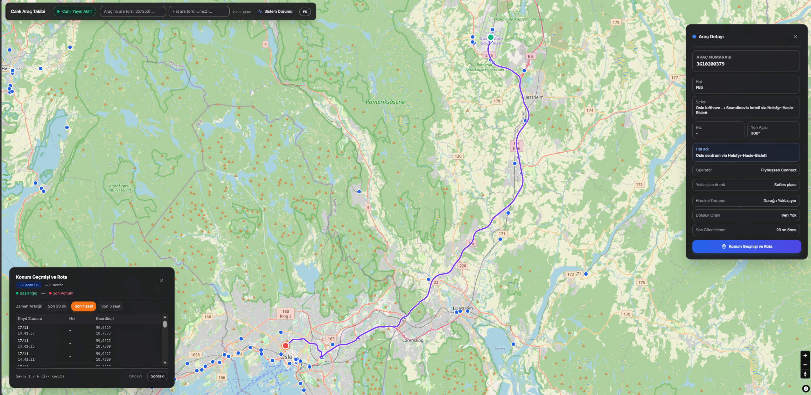
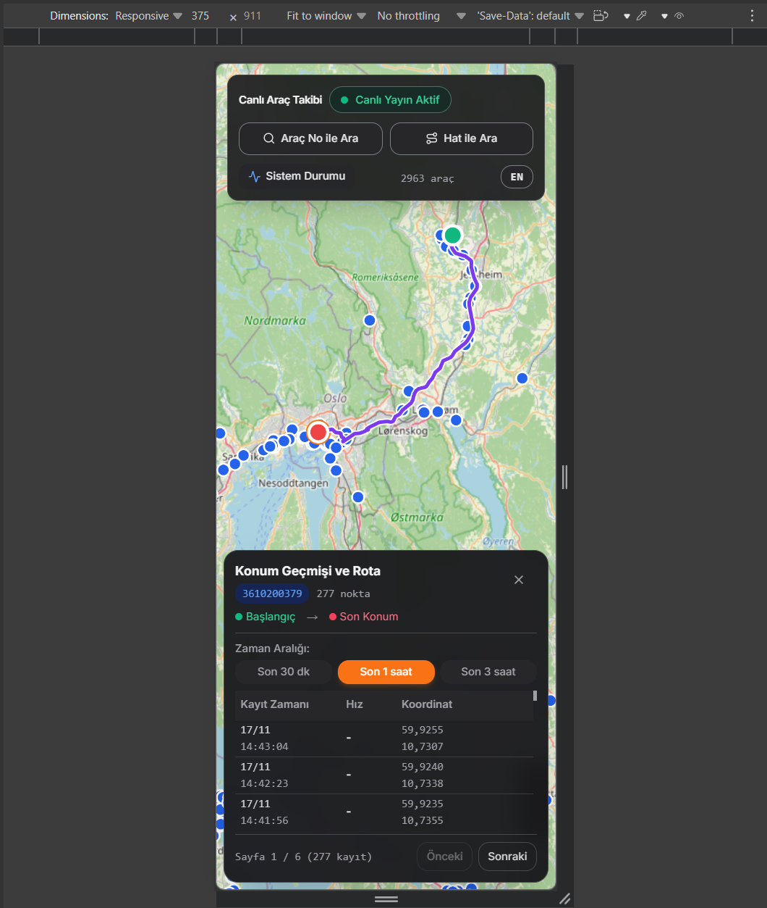
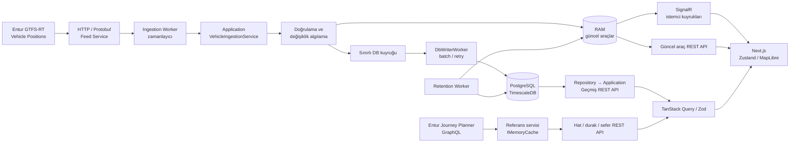
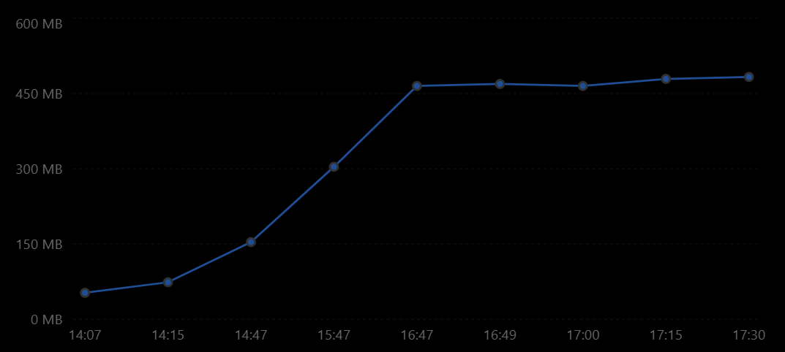
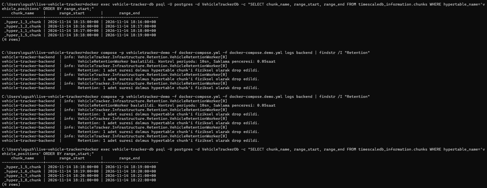

# Canlı Araç Takip Platformu

Norveç'teki toplu taşıma araçlarının konumlarını gerçek zamanlı haritada gösteren, geçmiş hareketlerini sorgulayan ve veri akışının durumunu izlemeye olanak sağlayan full-stack uygulama.

**Teknolojiler:** ASP.NET Core 10 · SignalR · PostgreSQL / TimescaleDB · Next.js 15 · React / TypeScript · MapLibre · Zustand · TanStack Query

Veri kaynağı, [Entur GTFS-Realtime Vehicle Positions](https://api.entur.io/realtime/v1/gtfs-rt/vehicle-positions) akışıdır. Uygulama bu kaynağı yaklaşık üç saniyelik aralıklarla sorgular; ekrandaki araçlar Norveç'teki tüm araçları değil, kaynağın o anda sağladığı konum kayıtlarını temsil eder.



## Neler yapıyor?

- **Canlı takip:** SignalR ile güncellenen MapLibre haritası, bağlantı durumu ve kopma sonrasında güncel durumla yeniden senkronizasyon.
- **Arama ve araç detayı:** Araç numarası veya hatla filtreleme; URL'de korunan aramalar; Entur Journey Planner verisi bulunabildiğinde okunabilir hat, durak ve sefer bilgileri.
- **Konum geçmişi:** 30 dakika, bir saat veya üç saat aralığında sunucu tarafında sayfalanmış kayıtlar ve harita üzerinde rota izi.
- **Operasyon görünürlüğü:** Son başarılı veri okuma, yazılan kayıtlar, başarısız denemeler, bağlı istemciler ve çalışma süresi.
- **Çift dil ve mobil arayüz:** Türkçe/İngilizce arayüz; 375 px genişlikte kontrol edilmiş mobil panel düzeni.

| Araç detayı | Geçmiş konumlar ve rota |
|---|---|
|  |  |

<details>
<summary>Mobil görünüm ve sistem metrikleri</summary>

**Mobil görünüm — Chrome DevTools, 375 px**



*Bu görüntü tarayıcı emülasyonunda alınmıştır; fiziksel telefon testi değildir.*

**Sistem durumu**


</details>

## Çalıştırma

Docker Engine / Docker Desktop ve Docker Compose gerekir. Proje kökünde `.env.example` dosyasını `.env` olarak kopyalayın ve **`POSTGRES_PASSWORD` için kendi parolanızı belirleyin**.

**Windows CMD**

```cmd
copy .env.example .env
notepad .env
docker compose up --build
```

**macOS / Linux**

```bash
cp .env.example .env
# .env dosyasında POSTGRES_PASSWORD değerini düzenleyin.
docker compose up --build
```

| Adres | İçerik |
|---|---|
| http://localhost:3000/tr | Türkçe arayüz |
| http://localhost:3000/en | İngilizce arayüz |
| http://localhost:5086/api/system/status | Sistem metrikleri |
| `/swagger` | Swagger UI (etkinleştirildiğinde; varsayılan Production kurulumunda kapalı) |

```bash
docker compose ps
docker compose logs --tail 50 backend
# Veritabanı volume'unu koruyarak kapatma
docker compose down
```

> `docker compose down -v` kullanmayın: veritabanı volume'unu silebilir. `.env` parolasını mevcut PostgreSQL volume'u oluşturulduktan sonra değiştirmek de veritabanı kullanıcısının parolasını otomatik olarak değiştirmez. Bu kurulum yerel geliştirme ve demo içindir; internete açık üretim dağıtımı olarak yapılandırılmamıştır.

## Mimari



**Canlı durum ile geçmiş farklı yollardan ilerler.** Araçların son gözlemleri bellekte tutulur ve SignalR aracılığıyla yayınlanır. Geçmiş kayıtları sınırlı bir kuyruktan toplu olarak TimescaleDB'ye yazılır; arayüz bunları REST üzerinden sorgular. Veri toplama zamanlamasını `VehicleIngestionWorker`, akışın orkestrasyonunu Application katmanındaki `VehicleIngestionService` yönetir. REST tarafında Controller, Application servisi ve repository sorumlulukları ayrılmıştır.

- **Veri kalitesi:** Eski veya yinelenen gözlemler ayıklanır. Eksik hız ve yön değerleri tahmin edilmez. Hat, durak veya sefer referansı bulunamadığında arayüz ilgili teknik kimliği yedek değer olarak gösterebilir.
- **Zaman serisi saklama:** `vehicle_positions`, gözlem zamanı (`observed_at`) üzerinden hypertable'dır. Varsayılan saklama penceresi üç saattir. Uygulama worker'ı süresi geçmiş chunk'ları fiziksel olarak kaldırır.
- **Kesintilere dayanıklılık:** Veritabanı geçici olarak erişilemez olduğunda writer yeniden dener. Yavaş SignalR istemcileri diğer istemcilerin yayın akışından ayrıştırılır; geride kalan istemciye güncel snapshot gönderilebilir.
- **İstemci durumu:** Canlı araçlar Zustand'da, geçmiş ve referans REST yanıtları TanStack Query'de yönetilir. Zod, gelen REST yanıtlarının şemasını doğrular.

## Ölçümler ve doğrulama

Aşağıdaki sonuçlar **yerel Docker ortamında alınmış belirli ölçümlerdir**; günün tamamını temsil etmez ve bir performans garantisi değildir.

### 17 Kasım 2026 — veri hacmi

| Ölçüm | Sonuç |
|---|---:|
| 13.00–15.00 arasında backend tarafından alınmış, DB'de bulunan kayıtlar (`received_at_utc` bazlı) | **1.062.601** |
| Saatlik ortalama (aynı iki saat, Türkiye saati) | **531.301 kayıt/saat** |
| Ölçüm anındaki hypertable kayıt sayısı | **1.441.600** |
| Hypertable boyutu (veri + indeksler) | **583 MB** |
| Chunk sayısı | **37** (sıkıştırılmış: 0) |
| Kaynak gözlemi → backend alımı gecikmesi, p95 | **18,05 sn** |

Saatlik kayıt sayısı, fiziksel `INSERT` anına göre değil `received_at_utc` alanına göre gruplandırılmıştır. Gecikme ölçümü, 14.00–15.00 aralığındaki 550.538 kayıt için `received_at_utc - observed_at` farkıdır; **tarayıcıya uçtan uca yayın gecikmesi değildir**. Aynı örneklemde `speed` alanı kayıtların **%83,32'sinde** yoktu. Bu nedenle araç detaylarında hızın sık sık `-` görünmesi beklenebilir.

**14 Kasım 2026 — saklama penceresi gözlemi:** Dört saati aşan ayrı bir çalışmada üç saatlik hypertable yaklaşık **483 MB** düzeyinde yataylaştı. Aşağıdaki grafik o gün alınan örnek noktaları gösterir; 17 Kasım'ın daha yüksek yazım trafiğiyle doğrudan aynı koşullarda değildir.



### Testler

- **Backend:** 59 Application + 4 WebAPI xUnit testi (17 Kasım doğrulama kayıtları).
- **Frontend:** 24 Vitest testi geçti; `npx tsc --noEmit` ve `npm run build` başarılı (17 Kasım).
- **Yavaş istemci:** Uygulama içi SignalR publisher testinde hızlı istemci **81/81 batch** aldı; blokaj kaldırılan yavaş istemci **1 güncel snapshot** ile toparlandı. Bu, uçtan uca WebSocket yük testi değildir.
- **Retention:** Kısa saklama penceresiyle ayrı Compose demosunda süresi dolan chunk'ların SQL ve log çıktılarıyla silindiği doğrulandı.

<details>
<summary>Dayanıklılık testlerinin çıktıları</summary>

**Yavaş istemci izolasyonu**


**Retention: önce / sonra**



</details>

Ana uygulamanın testlerini yerel ortamda yeniden çalıştırmak için .NET 10 SDK ve Node.js/npm gerekir:

```bash
dotnet test backend/VehicleTracker.Application.Tests/VehicleTracker.Application.Tests.csproj -c Release
dotnet test backend/VehicleTracker.WebApi.Tests/VehicleTracker.WebApi.Tests.csproj -c Release

cd frontend
npm ci
npx vitest run
npx tsc --noEmit
npm run build
```

## API

| Yöntem | Uç nokta |
|---|---|
| `GET` | `/api/vehicles/latest?routeId=&search=` |
| `GET` | `/api/vehicles/{vehicleId}/history?from=&to=&page=1&pageSize=50` |
| `GET` | `/api/vehicles/reference?routeId=&stopId=&tripId=` |
| `GET` | `/api/system/status` |
| SignalR | `/hubs/vehicles` (`ReceiveSnapshot`, `ReceiveUpdates`) |

Geçmiş API'si UTC zaman aralığı ve sunucu taraflı sayfalama kullanır. Entur Journey Planner üzerinden alınan sefer bilgileri planlanan güzergâh referanslarıdır; **anlık varış süresi (ETA) tahmini değildir**.

## Sınırlar ve geliştirme alanları

- **Kalıcılık:** Yazılmamış batch'ler RAM kuyruğunda olduğundan ani süreç/donanım arızasında veri kaybı olabilir. Kalıcı outbox veya dayanıklı mesaj kuyruğu mevcut değildir.
- **Rota izi:** Mevcut istemci en fazla iki sayfadan yaklaşık **1.000 geçmiş noktası** çizer. Çok yoğun araçlarda seçilen aralığın tamamını kapsamayabilir.
- **Ölçek ve test:** Çoklu backend dağıtımı, gerçek ağ altında yük testi, veritabanı entegrasyon testleri ve tarayıcı uçtan uca testleri geliştirmeye açıktır.
- **Güvenlik ve veri kapsamı:** Bu sürüm yerel demo amaçlıdır; genel internete açık kullanım için kimlik doğrulama, erişim kontrolü ve dağıtım sertleştirmesi gerekir. GTFS-RT Trip Updates ve Service Alerts akışları tüketilmez.

## Geliştirme notu

Bu projenin geliştirilmesinde **yapay zekâ araçlarından yararlanılmıştır**. Araçlar kod geliştirme, hata ayıklama, arayüz iyileştirmeleri ve dokümantasyon süreçlerinde destek amacıyla kullanılmış; uygulamanın davranışı testler ve yerel ölçümlerle değerlendirilmiştir.

**Veri ve harita atıfları:** [Entur](https://developer.entur.no/open-data/realtime) verileri [NLOD 2.0](https://data.norge.no/nlod/en/2.0) koşullarıyla sunulmaktadır. Harita altlığı © [OpenStreetMap katkıcıları](https://www.openstreetmap.org/copyright). Bu proje Entur tarafından onaylanmış veya desteklenmiş bir ürün değildir.
