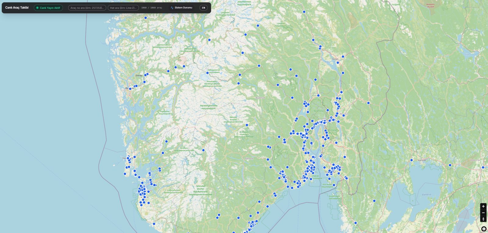
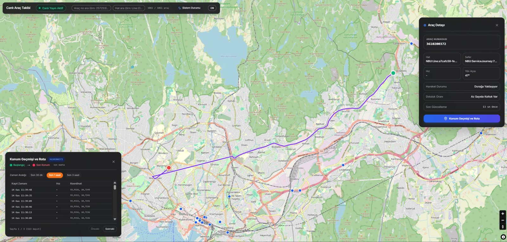
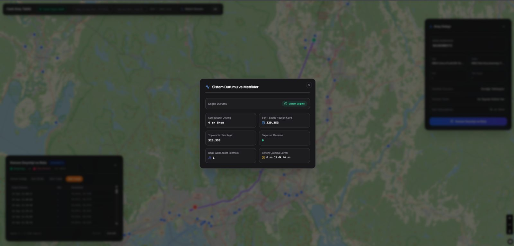
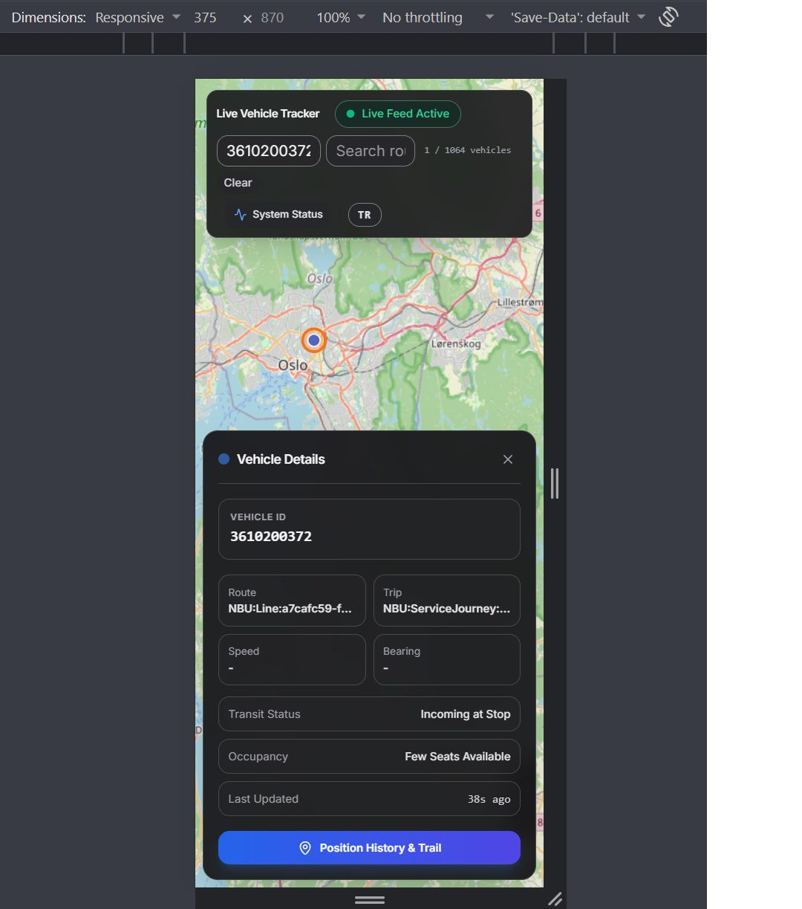
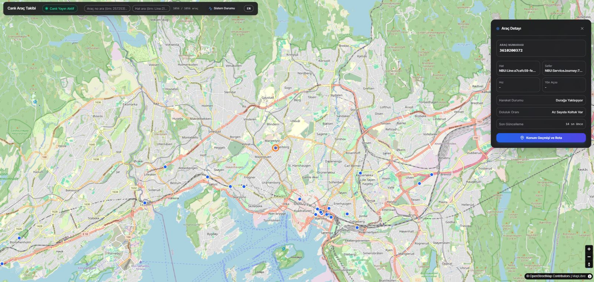
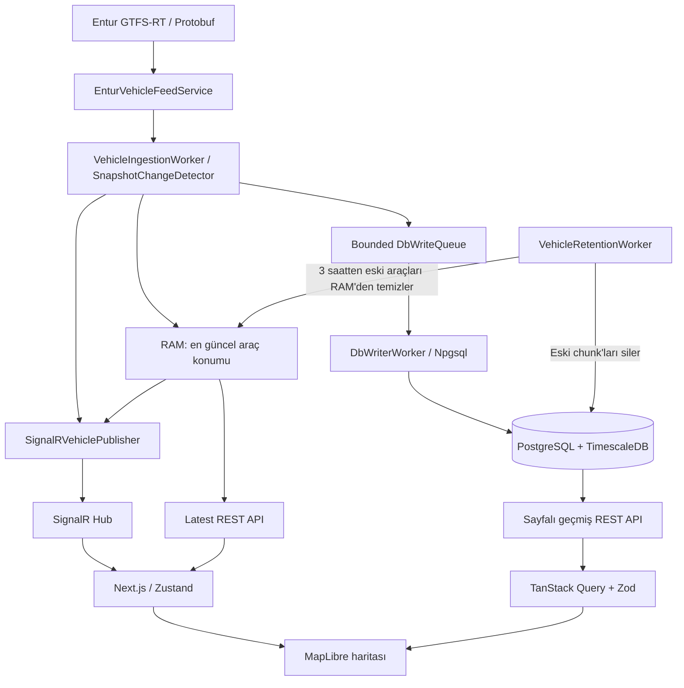
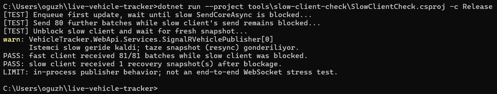

# Canlı Araç Takip Platformu

Entur'un Norveç genelindeki **GTFS-Realtime Vehicle Positions** akışını **3 saniyede bir** okuyup araçların güncel konumlarını **SignalR** üzerinden yayınlayan; geçmiş gözlemleri **PostgreSQL + TimescaleDB** üzerinde **3 saatlik kayan pencerede** saklayan full-stack uygulama.

**Tanıtım videosu:** [10–15 dakikalık Türkçe anlatım (YouTube)](https://youtu.be/WVF-gAUNnZc)
 
**Veri kaynağı:** [Entur – GTFS-RT Vehicle Positions](https://api.entur.io/realtime/v1/gtfs-rt/vehicle-positions). Bu feed, Norveç'teki bütün araçların eksiksiz listesi değil; Entur'a Vehicle Positions verisi sağlayan kaynakların anlık verisidir.



## Özellikler

- Canlı harita, hat/araç araması ve URL'de korunan filtreler.
- Canlı güncellenen araç detayı; seçilen aralık için **sayfalı geçmiş** ve harita üzerinde konum izi.
- Bağlantı durumu, otomatik yeniden bağlantı ve güncel snapshot ile senkronizasyon.
- Son başarılı okuma, saatlik yazım, başarısız denemeler ve bağlı istemcileri gösteren sistem paneli.
- **Türkçe / İngilizce** arayüz, **375 px** mobil genişlik için uyarlanmış düzen.

| Araç detayı ve geçmiş | Sistem durumu |
|---|---|
|  |  |

<details>
<summary>Mobil görünümü göster</summary>



*375 px görünüm, Chrome DevTools emülasyonunda kontrol edildi; fiziksel telefon testi değildir.*

</details>

<details>
<summary>Araç detay paneli ekran görüntüsü</summary>



</details>

## Kurulum

**Gereksinim:** Docker Desktop / Docker Engine ve Docker Compose.

```bash
# Reponun kök dizininde
# İlk kurulum için .env.example dosyasını .env olarak kopyalayabilirsiniz.
# Windows CMD: copy .env.example .env
# macOS/Linux: cp .env.example .env

docker compose up --build
```

İlk kurulumda Docker Compose, varsayılan **yerel geliştirme** değerleriyle de çalışabilir. `.env.example` içindeki `password123` **gerçek kullanım için güvenli parola değildir**. Yeni ve boş bir veritabanı kurarken `.env` içindeki `POSTGRES_PASSWORD` değerini değiştirin. **Mevcut PostgreSQL volume'u oluşturulduktan sonra yalnızca `.env` parolasını değiştirmek DB kullanıcısının parolasını değiştirmez.** Bu örnekte DB'nin `5432` portu host'a açıktır; internet erişimine açık bir üretim kurulumu olarak kullanılmamalıdır.

| Servis | Adres |
|---|---|
| Türkçe arayüz | http://localhost:3000/tr |
| İngilizce arayüz | http://localhost:3000/en |
| Swagger UI | http://localhost:5086/swagger |
| Sistem durumu | http://localhost:5086/api/system/status |
| SignalR Hub | `http://localhost:5086/hubs/vehicles` |

```bash
docker compose ps
docker compose logs --tail 50 backend
# Kapatma: mevcut DB volume'unu korur
docker compose down
```

> **Uyarı:** `docker compose down -v` veritabanının named volume'unu silebilir. Normal kapatma için kullanmayın.

## Mimari ve veri akışı



**İki farklı veri yolu:** Güncel durum ve canlı yayın RAM/SignalR üzerinden, kalıcı geçmiş sorguları TimescaleDB/REST üzerinden ilerler. PostgreSQL'in geçici durması canlı yayının da mutlaka durmasını gerektirmez; ancak RAM kuyruğu kalıcı bir mesaj sistemi değildir.

| Bileşen | Sorumluluk |
|---|---|
| `Domain` / `Application` | Araç modeli, interface'ler, filtreleme, değişiklik algılama ve DTO sözleşmeleri |
| `EnturVehicleFeedService` / `VehicleIngestionWorker` | HTTP/Protobuf okuma, gözlem doğrulama ve değişiklikleri dağıtma |
| `DbWriteQueue` / `DbWriterWorker` | Sınırlı RAM kuyruğu, toplu yazım ve DB hatasında yeniden deneme |
| `TimescaleRetentionService` / `VehicleRetentionWorker` | Süresi geçmiş hypertable chunk'larını ve backend RAM'indeki 3 saatten eski araç konumlarını periyodik temizleme |
| `SignalRVehiclePublisher` / `VehicleHub` | İstemci başına kuyruk; delta yayını ve gerektiğinde snapshot resync |
| `VehicleEndpoints` / `SystemEndpoints` | REST API, geçmiş sayfalama, sistem metrikleri |
| `useVehicleStore` (Zustand) | Araç kimliğiyle indeksli güncel canlı durum |
| TanStack Query / Zod | REST geçmiş sorguları, önbellek ve yanıt doğrulama |
| `LiveMap` (MapLibre) | GeoJSON source + WebGL layer ile binlerce aracın çizimi |

**Kullanılan teknolojiler:** ASP.NET Core 8, EF Core/Npgsql, PostgreSQL/TimescaleDB, SignalR; Next.js 15, React, TypeScript strict, Zustand, TanStack Query, Zod, next-intl, Tailwind CSS, shadcn/ui, MapLibre GL JS ve OpenStreetMap. Kaynak kodu `backend/` ve `frontend/` altında, katman/özellik bazlı ayrılmıştır.

## Tasarım kararları ve şartnamedeki sorular

### 1. Neden TimescaleDB; üç saatten eski veri nasıl siliniyor? On gün olsa ne değişir?

Redis yerine **PostgreSQL + TimescaleDB** tercih edildi; çünkü yalnızca anlık araç konumlarını değil, araç kimliği ve seçilen zaman aralığına göre sayfalanabilen **kalıcı konum geçmişini** de sorgulamak gerekiyor. Redis güncel durum önbelleği için değerlendirilebilirdi; bu projedeki zaman serisi sorguları ve retention ihtiyacı için TimescaleDB daha doğrudan bir çözüm sundu.

`vehicle_positions` tablosunu, `observed_at` üzerinden bir TimescaleDB hypertable olarak tutuyorum. Normal yapılandırmada **5 dakikalık chunk** aralığı, **3 saatlik retention** ve **60 saniyelik temizlik kontrolü** var. `VehicleRetentionWorker` ayrıca her kontrolde backend RAM'indeki üç saatten eski araç konumlarını `PruneStaleVehicles` ile temizliyor. Süresi dolan chunk'lar `drop_chunks` ile fiziksel olarak kaldırılıyor. Tek tek satır `DELETE` yerine chunk düşürmek büyük hacimde silme maliyetini azaltır. Bir chunk'ın tamamı süresi dolmadan kaldırılamayacağı için fiziksel pencere saniye hassasiyetinde değildir; geçmiş REST sorgusu istenen aralığı ayrıca sınırlar.

Aynı yaklaşım 10 gün için de uygulanabilir; ancak mevcut 5 dakikalık chunk aralığında yaklaşık **2.880 chunk** oluşur. Ölçtüğüm 483 MB / 3 saat oranı sabit kalsaydı 10 günde kabaca **93 milyon satır ve 39 GB hypertable boyutu** beklenirdi (yaklaşık 161 MB/saat). Bu bir doğrusal senaryo hesabı: gündüz/gece trafik farkı, indeksler ve gelecekteki veri dağılımı nedeniyle kesin kapasite tahmini değildir. 10 günlük yük testi yapmadım; böyle bir kullanımda chunk aralığını, sıkıştırma/arşivlemeyi, indeksleri ve diski yeniden planlardım.

Üç saat beklemeden silmeyi göstermek için `docker-compose.demo.yml` ile retention süresini 3 dakika, chunk süresini 1 dakika, temizlik kontrolünü 10 saniye yaptım. İlk sorguda 18:15, 18:16 ve 18:17 başlangıçlı eski chunk'lar vardı; ikinci sorguda artık yoktu. Test boyunca toplam **dört başarılı chunk silme logu** oluştu. Demo için ayrı `vehicletracker-demo_timescale_data` volume'unu kullandım. Normal `live-vehicle-tracker_timescale_data` volume'una geri döndüğümde **1.042.952** kayıt gördüm.


### 2. Veri ne zaman kaybolabilir; nasıl azaltıldı?

| Durum | Ne korunur? | Ne kaybolabilir, neden? |
|---|---|---|
| **Entur'a erişilemiyor / bozuk yanıt** | Yazılmış geçmiş ve eldeki canlı durum kalır. Hata kaydedilir, sonraki polling turunda yeniden istek yapılır. Geçersiz URL denememde HTTP **404** aldım; `failedPollAttempts` sayacı **6'dan 13'e** yükseldi. | Hiç alınmayan ara konumlar sonradan kaynaktan geri oynatılamaz. Bu denemede normal URL'ye dönüşü backend'i yeniden oluşturarak doğruladım. |
| **PostgreSQL yaklaşık 2 dakika kapalıyken** | Canlı yayın yolu çalışmayı sürdürdü; yazıcı RAM kuyruğundaki batch'i **1, 2, 4, 8, 16, en çok 30 saniye** beklemelerle yeniden denedi. DB açılınca yazımlar tekrar ilerledi. | Kuyruk **1.000 batch** ile sınırlı. Dolduğunda `BoundedChannelFullMode.Wait` yeni batch'in eklenmesini bekletir; bu da veri toplamanın duraklamasına ve kaynağın ara konumlarının kaçırılmasına yol açabilir. Backend aynı sırada ölürse yazılmamış RAM verisi de gider. |
| **Normal restart** | Writer kapanırken kuyruğu boşaltmaya çalışıyor; Docker'ın stop grace period'u **30 sn**, writer drain süresi **10 sn**. Testte `kuyruk bosaltildi` logunu gördüm. | Yazım hatası veya kapanış süresi aşılırsa bekleyen kayıtlar kaybolabilir. Normal restart için de koşulsuz sıfır kayıp garantisi vermiyorum. |
| **Ani `docker kill`** | TimescaleDB'ye önceden yazılmış satırlar korunur. Manuel başlatmayla uygulamanın toparlandığını gözlemledim. | RAM kuyruğunda bekleyen yazılmamış batch'ler kaybolabilir. Otomatik restart davranışını bu test doğrulamadı. |
| **WebSocket kopması / yavaş istemci** | Backend'in veri toplaması ve diğer istemciler devam edebilir. Yeniden bağlanan istemci güncel snapshot alır; her istemcinin **50 batch** sınırı var. | Kopukluk sırasında kaçırılan her ara delta yeniden oynatılmaz. Hedef, istemciyi *güncel araç durumuna* geri getirmektir. |

Veritabanında `(feed_entity_id, observed_at)` birleşik anahtarı ve `ON CONFLICT DO NOTHING` tekrar yazımları engelliyor. Kalıcı SQL veri hatası bir batch'i engellerse writer batch'i ikiye bölerek sağlam kayıtları yazmayı deniyor; tek başına kalan bozuk kaydı atlıyor. **Kalıcı disk kuyruğu/outbox yok; sıfır veri kaybı garantisi vermiyorum.**

`SystemMetricsService` sayaçları RAM'de tutuyor: `totalRecordsWritten` (bu backend süresince gerçekten yazılan satırlar), `recordsWrittenLastHour` (RAM'deki dakikalık sayaçların son saatlik toplamı) ve `failedPollAttempts` (bu süreçte başarısız polling denemeleri). Backend yeniden başlayınca sayaçlar sıfırlanır; TimescaleDB'de saklanan kayıtlar silinmez. `connectedClientCount` anlık bağlı istemcileri, `uptimeSeconds` mevcut sürecin çalışma süresini gösterir.

Yavaş istemci için gerçek `SignalRVehiclePublisher` ile **uygulama içi** test yaptım: İlk gönderimi bloke edilen istemci beklerken hızlı istemci **81/81 batch** aldı; yavaş istemci serbest bırakıldığında **1 kurtarma snapshot'ı** aldı. Bu bir gerçek ağ stres testi değil. Tarayıcı Offline/Online denemesinde yeniden bağlanmayı ve güncel duruma dönüşü ayrıca gözlemledim.



### 3. Canlı veri istemcide nerede ve neden tutuluyor?

**Zustand** ile SignalR delta'larından gelen güncel araçları `vehicleId` anahtarlı bir sözlükte tutuyorum. Araç başına yalnızca en güncel gözlemi saklamak ve eski zaman damgalı güncellemelerin yenilerini ezmesini engellemek hedeflenir. **TanStack Query** ise sayfalı geçmiş gibi **REST sunucu verisinin** alınması, önbelleklenmesi ve yeniden sorgulanması için kullanılır. Böylece canlı akışla geçmiş sorgusu birbirine karıştırılmaz. Haritada tek tek HTML işaretçileri yerine MapLibre GeoJSON source ve WebGL circle layer kullanılır.

Arama ve hat filtrelerini de URL'de koruyorum: `VehicleFilterBar`, değişikliği Zustand'a yansıtıyor; 250 ms debounce sonrasında `URLSearchParams` ve `history.replaceState` ile `search` / `routeId` parametrelerini güncelliyor. Sayfa ilk açıldığında `useSearchParams` bu filtreleri geri yüklüyor. Bu şekilde bağlantı paylaşılınca veya sayfa yenilenince seçim korunuyor.

İstemci tarafında **10 dakikadan eski** konumlar araç detayında bayat veri uyarısıyla gösterilir (`VEHICLE_STALE_WARN_MS`). **30 dakikadan eski** araçlar (`VEHICLE_EVICTION_MS`) güncel Zustand store’undan çıkarılır; temizleme kontrolü **60 saniyede bir** çalışır. Bu canlı harita politikası, backend’in **3 saatlik geçmiş saklama süresinden** farklıdır.

### 4. Gerçek Entur verisinde ne gözlemledim? Ölçülen performans ve hacim

Kodlamadan önce 6 Kasım 2026 gecesi `VehicleTracker.FeedProbe` ile **15 dakika boyunca 3 saniye aralıklarla 300 başarılı istek** yaptım. Şartname üç saniyede bir polling istiyor; Entur'un [resmî dokümanı](https://developer.entur.no/open-data/realtime) GTFS-RT tam veri kümesinin 15 saniyede bir güncellendiğini belirtiyor. Benim örneklemimde ilerleyen `FeedHeader.timestamp` adımları **5–10 saniye** arasındaydı. Bu, her aracın beş saniyede bir yeni konum ürettiği anlamına gelmiyor.

| Gözlem | Sonuç ve tasarıma etkisi |
|---|---|
| Aynı payload | **118/300** istekte öncekiyle birebir aynı içerik vardı; tekrarları ayıklama ihtiyacını gösterdi. |
| Header zamanı | **31/300** istekte en fazla 5 sn geriye gitti. GTFS Best Practices header zamanının azalmamasını öneriyor ve yük dengeleyici arkasındaki farklı örneklerin farklı zaman damgası döndürebileceğini yazıyor. Bunun olası bir açıklama olduğunu düşünüyorum ama doğrulayamadım; yalnızca header'a güvenip bütün konumları reddetmiyorum. |
| Entity / araç ayrımı | Son snapshot'ta **3.482 entity**, yalnızca **862 farklı `VehicleId`** vardı. **482** araç numarası birden fazla entity'de yer aldı; birinde **49 farklı entity ve TripId** bulundu. Kaynak entity'sini izlemek için `FeedEntityId`, canlı araç seçimi için `VehicleId` kullanıyorum. |
| Eski konumlar | Son snapshot'taki **2.138/3.482 (%61,4)** konum üç saatten eskiydi. Ölçüm başında eski olan **2.168** kaydın hiçbirinin konum zamanı 15 dakikada ilerlemedi. Bunları üç saatlik saklamaya almıyorum. |
| Opsiyonel alanlar | İstek başına ortalama **475 kayıtta `RouteId`**, **94 kayıtta `StopId`** ve **1.145 kayıtta `CurrentStopSequence`** eksikti. Alan yoksa sıfır veya uydurma değer yazmıyorum. |
| HTTP / protobuf | HTTP yanıt p50 **196 ms**, p95 **237 ms**; protobuf çözümleme p50 **4 ms**. |
| Gece yükü tahmini | Bu 15 dakikalık örneklem, kaynak zamanına göre yaklaşık **136 bin kayıt/saat** tahmini verdi. Gerçek DB yazım ölçümü değil; gün boyu sabit varsaymadım. |

GTFS-Realtime [Best Practices](https://gtfs.org/documentation/realtime/realtime-best-practices/), konum verilerinin ideal olarak 90 saniyeden eski olmamasını ve opsiyonel protobuf alanlarının varlığının kontrol edilmesini öneriyor. Gerçek Entur örneklemindeki eski konum oranı, kaynak verisini kabul etmeden önce zaman doğrulaması yapmam gerektiğini gösterdi. `FeedHeader.timestamp` paketin sunucuda üretildiği anı; `observed_at`/kaynak `Timestamp` ise tekil konumun ölçüm anını temsil ediyor. `ReceivedAtUtc` backend'in veriyi aldığı an. Üç saatlik saklama filtresini konumun ölçüm zamanına göre uyguluyorum. Bu yüzden backend yeni başlatıldığında bile ilk yanıttaki, son üç saat içinde ölçülmüş gözlemler veritabanına yazılabilir. Ne kadarının geleceği Entur’un o an gönderdiğine bağlı.

**14 Kasım 2026 — yerel Docker ortamı, dört saatten uzun çalışma:**

| Ölçüm | Sonuç |
|---|---|
| Saatlik gerçek DB yazımı | Örnek iki SQL saatinde **364.369** ve **371.575 satır**; ayrı bir API ölçümünde `recordsWrittenLastHour=388696` (çalışma zamanı sayacı) |
| Üç saatlik tablo | **1.168.063 satır**, yaklaşık **483 MB** hypertable boyutu |
| Saatlik satır hacmi | Bu gözlemlerde yaklaşık **365–390 bin satır/saat** |
| Saatlik disk boyutu | Üç saat / 483 MB üzerinden yaklaşık **161 MB/saat** (doğrusal oran hesabı, ayrı saatlik disk ölçümü değil) |
| Ingestion okuma döngüsü | Log örneklerinde çoğunlukla **100–160 ms**, koşula bağlı olarak değişiyor |
| Frontend GeoJSON hazırlama + `setData` | Yaklaşık **1.000 araç için 0,5–1,4 ms**; tüm harita render süresi veya FPS değil |
| Testler | Backend **8/8 xUnit**; frontend `npm run build` başarılı, lint **0 hata / 1 uyarı** |

İlk saatlerde hypertable boyutu büyüdü; üç saatlik saklama penceresi doldukça yaklaşık **483 MB** düzeyinde yataylaşma gözlemledim. Bu grafik farklı saatlerde aldığım örnek boyut ölçümlerini gösteriyor; tüm olası yüklerde aynı boyutu garanti etmiyor.


Gece FeedProbe tahmini (**136 bin/saat**) ile daha sonraki gerçek gündüz SQL ölçümü (**365–372 bin/saat**) farklı koşullara ait. Bu yüzden 10 günlük **93 milyon satır / 39 GB** hesabını kesin tahmin olarak değil, yalnızca gündüz ölçülen üç saatlik yükün kesintisiz sürmesi varsayımıyla sundum.

### 5. Bilinen eksikler ve sonraki adımlar

- **Kalıcı kuyruk yok:** Ani process/donanım arızasında henüz DB'ye yazılmamış kayıtları korumak için disk spool/outbox veya dayanıklı mesaj altyapısı tercih ederdim.
- **Ağ ölçeklemesi:** Hat/bölge bazlı SignalR abonelikleri, birden fazla backend instance'ı için ortak yayın altyapısı ve gerçek ağ altında yük testi eklerdim. Şimdiki publisher entity modelini yayımlıyor; API için hazırlanmış DTO sözleşmesinin her yerde uygulanması sonraki iyileştirme olabilir.
- **Geçmiş çizgisi:** Şu anda harita izi için ilk iki sayfadan en çok yaklaşık **1.000 nokta** yükleniyor; yoğun bir araçta tüm 3 saatlik hareket kapsanmayabilir. Cursor tabanlı sorgu veya çizgi sadeleştirme geliştirirdim.
- **Test kapsamı:** Gerçek DB ile Testcontainers, frontend Vitest/Playwright senaryoları ve otomatik uçtan uca kesinti testleri eklerdim.
- **Mimari ödünleşim:** Ingestion akışının orkestrasyonu Infrastructure katmanındaki worker'da. Daha büyük projede uygulama akışını Infrastructure ayrıntılarından daha net ayırırdım.
- **Güvenlik:** Bu repo yerel demo odaklıdır; örnek parola, host'a açık DB portu, geliştirme CORS/Swagger ayarları ve kimlik doğrulama eksikliği üretim öncesinde giderilmeli. JWT koruması bonus kapsamındaydı; uygulanmadı.
- **Veri kapsamı:** Zorunlu **Vehicle Positions** akışı uygulandı. **Trip Updates**, **Service Alerts** ve statik GTFS zenginleştirmesi henüz uygulanmadı.

## API ve doğrulama

| Yöntem | Uç nokta |
|---|---|
| GET | `/api/vehicles/latest?routeId=&search=` |
| GET | `/api/vehicles/{vehicleId}/history?from=&to=&page=1&pageSize=50` |
| GET | `/api/system/status` |
| SignalR | `/hubs/vehicles` (`ReceiveSnapshot`, `ReceiveUpdates`) |

REST uç noktaları Swagger UI üzerinden incelenebilir; mevcut servis Swagger **2.0** biçiminde API belgesi üretir. Geçmiş sorguları **UTC zaman aralığı** ve sunucu taraflı sayfalama kullanır.

```bash
# Backend unit testleri (yerel .NET 8 SDK gerekir)
dotnet test backend/VehicleTracker.Application.Tests/VehicleTracker.Application.Tests.csproj

# İsteğe bağlı: uygulama içi SignalR yavaş istemci testi
dotnet run --project tools/slow-client-check/SlowClientCheck.csproj -c Release

# Frontend build/lint (yerel Node/npm gerekir)
cd frontend
npm ci
npm run build
npm run lint
```

### Kısa retention demosunun yeniden çalıştırılması

Demo ve normal Compose ortamı aynı host portlarını/container isimlerini kullanır; **aynı anda başlatılmamalıdır**. İlk normal volume'u (`live-vehicle-tracker_timescale_data`) koruduğunuzu doğrulayın. `down -v` kullanmayın.

```bash
docker compose down
docker compose -p vehicletracker-demo -f docker-compose.yml -f docker-compose.demo.yml up -d --build
# Demo volume'u: vehicletracker-demo_timescale_data
# Backend loglarında fiziksel chunk silme mesajları gözlenebilir.
docker compose -p vehicletracker-demo -f docker-compose.yml -f docker-compose.demo.yml down
docker compose up -d
```

**Veri ve harita atıfları:** Bu uygulama [Entur](https://developer.entur.no/open-data/realtime) tarafından erişime açılan GTFS-Realtime Vehicle Positions verilerini içerir. Entur verileri [Norwegian Licence for Open Government Data (NLOD 2.0)](https://data.norge.no/nlod/en/2.0) kapsamında sunulur. Ham feed'i protobuf'dan uygulama modellerine dönüştürdüm; eski/tekrarlanan konumları ayıkladım ve güncel araç durumuna göre birleştirdim. Bu çalışma Entur tarafından onaylanmış veya desteklenmiş bir ürün değildir. Harita altlığı © [OpenStreetMap katkıcıları](https://www.openstreetmap.org/copyright).

Ölçüm ve dayanıklılık sonuçları yalnızca belirtilen test koşulları için geçerlidir; kaynak sistemin tüm araçlarına veya sıfır veri kaybına ilişkin garanti verilmez.
